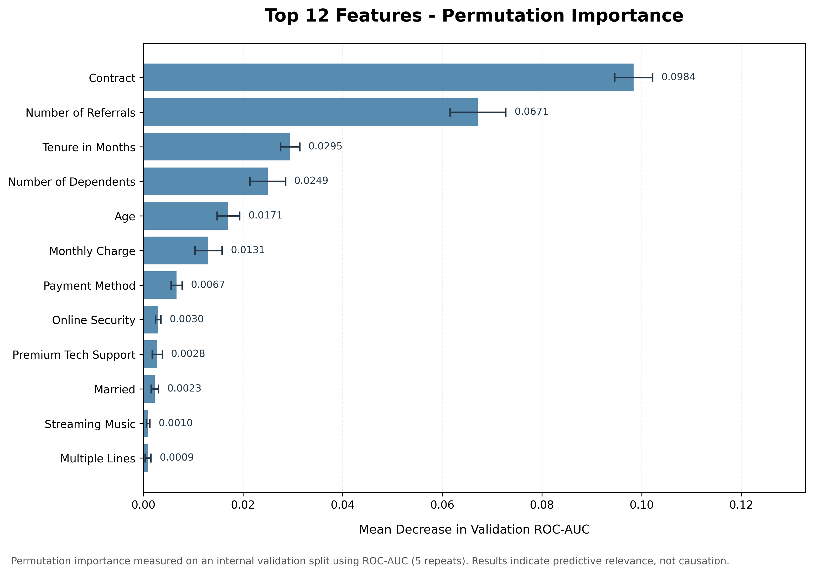
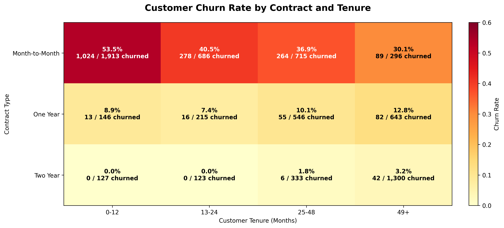
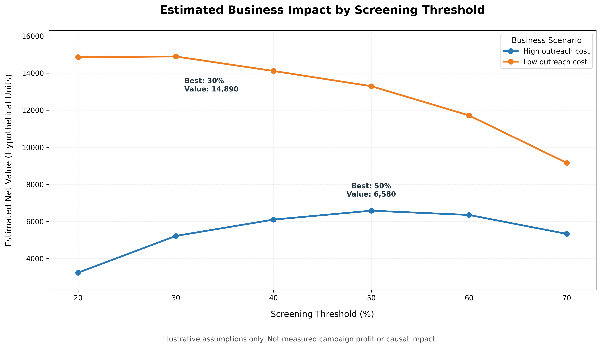

# Customer Churn Prediction
### Business-Oriented Machine Learning & Retention Analytics

An end-to-end analytical machine learning project focused on understanding telecom customer churn, comparing predictive models, interpreting important features, analyzing customer segments, and exploring business retention decisions.

The project combines **predictive modeling**, **exploratory business analysis**, and an interactive **Streamlit dashboard**.

> **Project scope:** This repository focuses on analytical machine learning and business decision support. A separate [Churn MLOps Pipeline](https://github.com/Zahra-ziaee/churn-mlops-pipeline) project demonstrates API development, testing, and deployment-oriented ML engineering.

---

## 1. Business Problem

Customer churn is a challenge for subscription-based businesses.

Identifying customers who are more likely to leave may help businesses investigate retention opportunities, allocate outreach resources, and evaluate possible interventions.

This project explores five questions:

1. Which customer characteristics are associated with churn?
2. Which machine learning model provides the strongest predictive performance?
3. Which customer segments account for the largest number of churn cases?
4. How does the classification threshold affect precision and recall?
5. How might customer value and outreach costs influence retention decisions?

The goal is not only to generate predictions, but also to connect model evaluation with business reasoning.

---

## 2. Dataset

The project uses the **Maven Analytics Telecom Customer Churn** dataset.

The data describes customer demographics, subscriptions, contracts, billing information, and churn status at the end of Q2 2022.

### Dataset Overview

| Metric | Value |
|---|---:|
| Customers | 7,043 |
| Original columns | 38 |
| Original modeling features | 32 |
| Updated modeling features | 25 |
| Churned customers | 1,869 |
| Observed churn rate | 26.54% |
| Target | `Churn` |

### Target Definition

The original `Customer Status` column is converted into a binary target:

| Original status | Churn |
|---|---:|
| Churned | 1 |
| Stayed | 0 |
| Joined | 0 |

**Important limitation:** The `Joined` category is included in the non-churn class for consistency with the source project's target definition. This simplification may not represent a rigorous future-churn prediction problem for newly joined customers.

### Data Files

Place the three original CSV files in `data/raw/`:

```text
data/raw/
├── telecom_customer_churn.csv
├── telecom_data_dictionary.csv
└── telecom_zipcode_population.csv
```

The raw dataset is not intended to be committed to GitHub.

---

## 3. Leakage-Aware Feature Selection

A major improvement in the project is the reduction from **32 to 25 predictive features**.

Feature selection is based on a conservative assessment of information availability, potential target leakage, and generalization.

### Excluded Features

| Group | Excluded columns | Reason |
|---|---|---|
| Identifier | `Customer ID` | Unique customer identifier |
| Post-churn information | `Churn Category`, `Churn Reason` | Recorded in connection with customer departure |
| Geographic information | `City`, `Zip Code`, `Latitude`, `Longitude` | Conservative exclusion to reduce geographic dependence and overfitting risk |
| Cumulative financial information | `Total Charges`, `Total Refunds`, `Total Extra Data Charges`, `Total Long Distance Charges`, `Total Revenue` | Potential timing and information-availability concerns |

`Customer Status` is transformed into the target and excluded from the model inputs.

The resulting predictive dataset contains:

- 7,043 observations
- 25 model features
- 1 binary target

### Important Methodological Note

Removing these features does not prove that the remaining dataset is free of leakage.

The source data describes customers at the end of a fiscal quarter, and some remaining features may also reflect information observed at that time.

Without historical snapshots recorded before the churn outcome, strict temporal validity cannot be established.

The model should therefore be interpreted as an analytical churn classifier, not as a prospectively validated future-churn forecasting system.

Excluded variables remain available in the original dataset for appropriate descriptive and business analysis.

---

## 4. Project Structure

```text
customer-churn-prediction/
│
├── app/
│   └── streamlit_app.py
│
├── src/
│   ├── __init__.py
│   ├── config.py
│   ├── data_loader.py
│   ├── preprocessing.py
│   ├── models.py
│   ├── evaluation.py
│   ├── visualization.py
│   └── utils.py
│
├── data/
│   ├── raw/
│   └── processed/
│
├── results/
│   ├── figures/
│   │   ├── churn_distribution.png
│   │   ├── churn_rate_by_contract_tenure.png
│   │   ├── feature_importance_25features_permutation.png
│   │   └── business_impact_by_threshold.png
│   │
│   ├── model_results_baseline_32features.csv
│   ├── model_cv_25features.csv
│   ├── threshold_cv_25features.csv
│   ├── feature_importance_25features_permutation.csv
│   ├── churn_segmentation_by_tenure_contract.csv
│   └── business_impact_scenarios.csv
│
├── main.py
├── compare_models_cv.py
├── analyze_thresholds_cv.py
├── analyze_business_impact.py
├── analyze_churn_segments.py
├── analyze_feature_importance_25.py
├── plot_churn_segments.py
├── plot_feature_importance_25.py
├── plot_business_impact.py
├── requirements.txt
├── .gitignore
└── README.md
```

The original repository also contains historical model-comparison outputs and screenshots. Those older visualizations should not be confused with the new 25-feature cross-validation results.

---

## 5. Machine Learning Methodology

### 5.1 Data Preparation

The preprocessing workflow includes:

- Binary target creation
- Semantic handling of selected missing service values
- Removal of excluded modeling features
- Separation of predictors and target
- Stratified train/test splitting

Numerical and categorical features are processed using scikit-learn pipelines.

Numerical preprocessing includes:

- Median imputation
- Standard scaling

Categorical preprocessing includes:

- Most-frequent imputation
- One-hot encoding

These fitted preprocessing steps are contained inside the model pipelines, helping prevent preprocessing statistics from being learned using validation folds.

### 5.2 Train/Test Split

The dataset is divided using a stratified split:

| Partition | Customers |
|---|---:|
| Training | 5,634 |
| Test | 1,409 |

Configuration:

```python
TEST_SIZE = 0.20
RANDOM_STATE = 42
```

The updated model-selection workflow uses **three-fold Stratified Cross-Validation on the training partition only**.

The original test partition is not used for selecting the current model.

However, the same dataset's test partition was examined during earlier project development. It must not be described as a completely untouched independent holdout.

### 5.3 Candidate Models

The project compares:

1. Logistic Regression
2. Random Forest
3. Gradient Boosting

All three models use preprocessing pipelines.

---

## 6. Cross-Validation Results

Models were compared using three-fold Stratified Cross-Validation on the 5,634 training observations.

| Model | ROC-AUC | F1 | Precision | Recall |
|---|---:|---:|---:|---:|
| **Gradient Boosting** | **0.9092** | **0.7050** | **0.7451** | 0.6689 |
| Logistic Regression | 0.8964 | 0.6870 | 0.5768 | **0.8495** |
| Random Forest | 0.8944 | 0.6970 | 0.6259 | 0.7866 |

These are mean cross-validation scores, not final independent test-set metrics.

### Model Selection

**Gradient Boosting** achieved the highest observed mean ROC-AUC and F1-score among the three evaluated models.

Logistic Regression, however, achieved substantially higher recall at its default prediction threshold.

This illustrates an important business consideration:

> The highest-scoring model on a general evaluation metric is not automatically the best model for every retention strategy.

The preferred model and classification threshold depend on the business objective, intervention cost, available resources, and consequences of missed churn cases.

### Historical Benchmark

The earlier 32-feature Gradient Boosting configuration reported:

| Metric | Historical result |
|---|---:|
| Accuracy | 0.8460 |
| Precision | 0.7357 |
| Recall | 0.6551 |
| F1 | 0.6931 |
| ROC-AUC | 0.9115 |

These historical metrics come from the earlier test-set evaluation.

They should **not** be directly compared with the new training-only cross-validation scores as if both were produced using identical evaluation procedures.

The preserved historical output is available in:

```text
results/model_results_baseline_32features.csv
```

---

## 7. Permutation Feature Importance

The updated project uses **Permutation Importance** to estimate the predictive relevance of each of the 25 features.

The method measures how much validation ROC-AUC changes when the values of an individual feature are randomly shuffled.

### Methodology

- Model: Gradient Boosting
- Analysis data: Internal split of the training partition
- Model-fitting samples: 4,225
- Validation samples: 1,409
- Permutation repetitions: 5
- Evaluation metric: ROC-AUC

The original test partition is not used for this analysis.

### Most Important Features

| Feature | Mean ROC-AUC decrease |
|---|---:|
| Contract | 0.09839 |
| Number of Referrals | 0.06713 |
| Tenure in Months | 0.02946 |
| Number of Dependents | 0.02495 |
| Age | 0.01706 |
| Monthly Charge | 0.01307 |

`Contract` showed the largest measured permutation importance in this validation analysis.

### Visualization



### Interpretation Limitations

- Importance values are not percentages of model contribution.
- Correlated features may share or mask predictive importance.
- Near-zero or negative permutation importance does not necessarily prove that a feature is useless.
- The analysis model was fitted on an internal training subset, rather than the full training partition used by the Streamlit model.
- Permutation importance does not establish causal effects.

Detailed output:

```text
results/feature_importance_25features_permutation.csv
```

---

## 8. Customer Churn Segmentation

In addition to predictive modeling, the project examines observed churn patterns across customer segments.

The primary segmentation uses:

- Contract type
- Customer tenure

### Churn Rate by Contract Type

| Contract | Customers | Observed churn rate |
|---|---:|---:|
| Month-to-Month | 3,610 | 45.84% |
| One Year | 1,550 | 10.71% |
| Two Year | 1,883 | 2.55% |

Month-to-month customers show substantially higher observed churn rates.

However, contract type may also be associated with other customer characteristics, including tenure.

### Contract and Tenure Analysis

Customers are divided into four tenure groups:

- 0–12 months
- 13–24 months
- 25–48 months
- More than 48 months

The analysis calculates:

- Number of customers per segment
- Number of churned customers
- Segment churn rate
- Share of all observed churn cases

### Churn Segmentation Heatmap



### Key Business Finding

The segment with:

- Month-to-month contracts
- 0–12 months of tenure

contains:

| Measure | Value |
|---|---:|
| Customers | 1,913 |
| Churned customers | 1,024 |
| Segment churn rate | 53.53% |
| Share of all churn cases | 54.79% |

This segment accounts for more than half of observed churn cases in the dataset.

### Business Interpretation

The finding suggests that newer month-to-month customers deserve particular attention in further retention research.

Potential business hypotheses include:

- Whether improved onboarding increases customer retention
- Whether early support outreach is beneficial
- Whether specific offers improve engagement
- Whether service-related problems are concentrated in this segment

These are hypotheses for future testing.

The observational data does not demonstrate that changing contract length or providing an offer would cause churn to decrease.

Detailed results:

```text
results/churn_segmentation_by_tenure_contract.csv
```

---

## 9. Classification Threshold Analysis

Churn prediction is a classification and risk-scoring problem.

Using the default 50% classification threshold may not match every business objective.

The project evaluates several thresholds using **out-of-fold predictions generated from the training partition**.

### Threshold Comparison

| Threshold | Precision | Recall | F1 | Flagged customers |
|---|---:|---:|---:|---:|
| 20% | 0.5697 | 0.8856 | 0.6934 | 2,324 |
| **30%** | 0.6350 | 0.8214 | **0.7162** | 1,934 |
| 40% | 0.6904 | 0.7398 | 0.7142 | 1,602 |
| 50% | 0.7452 | 0.6689 | 0.7050 | 1,342 |
| 60% | 0.7959 | 0.5712 | 0.6651 | 1,073 |
| 70% | 0.8484 | 0.4341 | 0.5743 | 765 |

### Findings

- Lower thresholds generally identify more actual churn cases.
- Higher thresholds generally improve precision but miss more churn cases.
- A 30% threshold achieved the highest observed F1 among the tested thresholds.
- The difference between the 30% and 40% F1 scores was small.

The 30% threshold is used as an **illustrative screening threshold** in the Streamlit dashboard.

This is not a prospectively validated or universally optimal operational threshold.

Because thresholds were compared using the same out-of-fold predictions, selecting the maximum observed score may introduce selection optimism.

Detailed results:

```text
results/threshold_cv_25features.csv
```

---

## 10. Hypothetical Business Impact Analysis

A central goal of this project is to demonstrate that model decisions should consider business costs.

The project evaluates two illustrative customer outreach scenarios.

### Business Assumptions

| Parameter | Assumed value |
|---|---:|
| Value of preventing one churn event | 200 units |
| Probability of successful retention among true-positive contacted customers | 10% |
| Low-cost outreach | 5 units per contacted customer |
| High-cost outreach | 10 units per contacted customer |

All values are hypothetical.

### Estimated Net Value

The scenario model uses:

```text
Expected Saved Customers
    = True Positives × Assumed Retention Success Rate

Expected Retention Value
    = Expected Saved Customers × Customer Value

Outreach Cost
    = Flagged Customers × Cost per Contact

Estimated Net Value
    = Expected Retention Value − Outreach Cost
```

### Best Observed Threshold by Scenario

| Scenario | Best tested threshold | Estimated net value |
|---|---:|---:|
| Low outreach cost | 30% | 14,890 units |
| High outreach cost | 50% | 6,580 units |

### Business Impact Visualization



### Interpretation

The best observed threshold changes when the cost of contacting customers changes.

A lower outreach cost may justify screening a larger group of customers.

A higher outreach cost may favor a more selective strategy.

The analysis demonstrates how business assumptions can affect model decisions.

**Important:** These are modeled scenarios, not observed campaign profits.

The dataset does not contain randomized intervention outcomes or measured retention campaign effects.

The analysis also does not model every operational consideration, such as outreach capacity, customer fatigue, heterogeneous treatment effects, or uncertainty in the assumed retention success rate.

Detailed results:

```text
results/business_impact_scenarios.csv
```

---

## 11. Interactive Streamlit Dashboard

The project provides an interactive Streamlit dashboard for exploring the analytical results and testing customer profiles.

### Dashboard Sections

**Dataset Overview**
- Customer count
- Number of predictive features
- Observed churn rate

**Model Summary**
- Selected Gradient Boosting model
- Training-only cross-validation metrics
- Model comparison table

**Permutation Feature Importance**
- Top 12 feature-importance visualization
- Detailed table for all 25 features
- Methodological interpretation

**Customer Churn Segmentation**
- Contract and tenure heatmap
- Segment-level churn statistics
- Business insights

**Business Decision Analysis**
- Estimated business impact chart
- Best observed thresholds under two scenarios
- Detailed hypothetical economic results
- Threshold performance comparison

**Interactive Prediction**
- Explicit input values for all 25 predictive features
- Service-dependent input consistency
- Estimated churn probability
- Illustrative 30% screening decision
- Display of all 25 values used for the prediction

### Prediction Interpretation

The dashboard uses a Gradient Boosting pipeline fitted on the training partition.

A customer is flagged for further retention review when:

```text
Estimated Churn Probability >= 0.30
```

The 30% threshold is illustrative.

Prediction scores have not been independently calibrated.

The dashboard should be treated as a portfolio demonstration and analytical exploration tool, not a production-ready retention decision system.

---

## 12. How to Run

The commands below are intended for Windows Command Prompt (CMD).

### Step 1 — Clone the Repository

```cmd
git clone https://github.com/Zahra-ziaee/customer-churn-prediction.git
cd customer-churn-prediction
```

### Step 2 — Create a Virtual Environment

```cmd
python -m venv .venv
```

### Step 3 — Install Dependencies

```cmd
.venv\Scripts\python.exe -m pip install -r requirements.txt
```

The current requirements file reflects the project's existing development environment and is scheduled for dependency cleanup and reproducibility testing.

### Step 4 — Add the Dataset

Place the three original CSV files in:

```text
data/raw/
```

### Step 5 — Run the Main ML Analysis

```cmd
.venv\Scripts\python.exe main.py
```

This command prepares the 25-feature dataset, produces the churn-distribution chart, and runs training-only cross-validation for model comparison.

### Step 6 — Generate Threshold Analysis

```cmd
.venv\Scripts\python.exe analyze_thresholds_cv.py
```

### Step 7 — Generate Hypothetical Business Analysis

```cmd
.venv\Scripts\python.exe analyze_business_impact.py
.venv\Scripts\python.exe plot_business_impact.py
```

### Step 8 — Generate Customer Segmentation

```cmd
.venv\Scripts\python.exe analyze_churn_segments.py
.venv\Scripts\python.exe plot_churn_segments.py
```

### Step 9 — Generate Feature Importance

```cmd
.venv\Scripts\python.exe analyze_feature_importance_25.py
.venv\Scripts\python.exe plot_feature_importance_25.py
```

### Step 10 — Launch Streamlit

```cmd
.venv\Scripts\python.exe -m streamlit run app/streamlit_app.py
```

The dashboard is normally available at:

```text
http://localhost:8501
```

The dashboard loads the generated analysis outputs and fits its prediction pipeline on the training partition.

---

## 13. Generated Outputs

### Model Evaluation

```text
results/model_cv_25features.csv
results/threshold_cv_25features.csv
```

### Feature Interpretation

```text
results/feature_importance_25features_permutation.csv
results/figures/feature_importance_25features_permutation.png
```

### Customer Segmentation

```text
results/churn_segmentation_by_tenure_contract.csv
results/figures/churn_rate_by_contract_tenure.png
```

### Business Decision Analysis

```text
results/business_impact_scenarios.csv
results/figures/business_impact_by_threshold.png
```

### Historical Reference

```text
results/model_results_baseline_32features.csv
```

The historical results are retained for documentation and should not be presented as an independent evaluation of the updated model.

---

## 14. Limitations

This project has several important limitations.

### Cross-Sectional Data

The dataset is primarily a single-period snapshot.

It does not provide a complete historical sequence of customer records before churn.

### Temporal Leakage Risk

Some variables are measured at the end of the observation quarter.

The conservative feature-selection policy reduces certain risks but does not guarantee that all remaining features would have been available before the outcome.

### Previously Examined Test Data

The dataset's original test partition was used in earlier project development.

The updated cross-validation workflow avoids using that partition for current model selection, but the historical exposure prevents describing it as a pristine independent holdout.

### Threshold Selection

The preferred threshold was selected from observed training-only out-of-fold results and hypothetical business scenarios.

Its expected performance has not been independently confirmed.

### Probability Calibration

Predicted churn probabilities have not been independently calibrated.

### Observational Business Analysis

Correlations between customer features and churn do not prove causal effects.

The segmentation findings do not demonstrate that any specific intervention would reduce churn.

### Hypothetical Retention Economics

The business scenarios use assumed costs, customer value, and retention effectiveness.

They do not represent measured profits or experimental outcomes.

### Operational Readiness

The application has not been validated as a production retention system.

Automated testing, dependency cleanup, and independent prospective evaluation remain future improvements.

---

## 15. Technologies

- Python
- Pandas
- NumPy
- Scikit-learn
- Matplotlib
- Streamlit
- Git and GitHub
- Classification
- Cross-Validation
- Permutation Importance
- Customer Segmentation
- Business Analytics

---

## 16. Future Improvements

Potential next steps include:

- Automated tests for preprocessing and prediction inputs
- SHAP-based explanations
- Probability calibration
- Nested validation or an independently collected evaluation dataset
- Additional customer segmentation
- Sensitivity analysis for retention assumptions
- Controlled experiments for measuring actual retention effects
- Dependency cleanup and clean-environment reproducibility testing
- Updated dashboard screenshots

---

## 17. Portfolio Positioning

This repository is designed to demonstrate business-focused Data Science skills:

- Translating a business problem into an ML task
- Building leakage-aware preprocessing pipelines
- Comparing classification algorithms
- Understanding precision-recall tradeoffs
- Interpreting feature importance
- Identifying high-churn customer segments
- Evaluating hypothetical business tradeoffs
- Communicating findings through an interactive dashboard

The companion [Churn MLOps Pipeline](https://github.com/Zahra-ziaee/churn-mlops-pipeline) repository focuses on engineering and serving an ML model.

Together, the projects emphasize different aspects of the machine learning lifecycle.

---

## Author

**Zahra Ziaee**

M.Sc. Computer Science — Data Mining

GitHub: [Zahra-ziaee](https://github.com/Zahra-ziaee)

Focus: Data Science, Machine Learning, Customer Analytics, and Data-Driven Decision Making.
